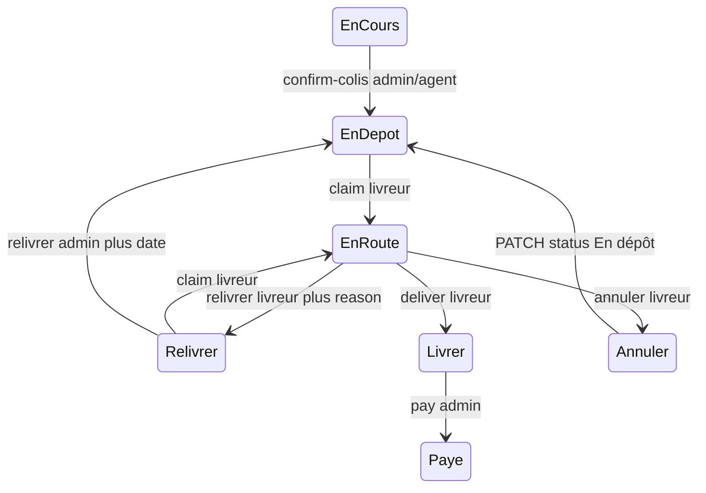

# Flutter integration against Next.js `/api/mobile`

Single backend: this Next.js app. Flutter never talks to Odoo. Envelope `{ success, data }` / `{ success: false, error: { code, message } }`. IDs are numeric strings (`"83678"`). Display `HT${id}`.

Base URL stays dart-define (`http://10.0.2.2:3000/api/mobile` on Android emulator). Default production URL in [lib/config/api_config.dart](lib/config/api_config.dart) can stay Vercel; local runs use `--dart-define=API_BASE_URL=...`. Cleartext HTTP is already enabled.

Roles unchanged: `business_client` / `admin` / `agent` / `delivery_person`. Agent does **not** create accounts or write vehicles.

---

## Gap vs current Flutter (integrate these)

Already wired, but **request/response shapes are wrong** and must be fixed:

- `POST /scanner/lookup` currently `{ code }` — spec: `{ "id": "83678" }`, data `{ found, order }`
- `POST /commandes/:id/confirm-colis` currently `{ vehicle_id, livreur_id, delivery_date }` — spec: `{ deliveryDate, vehicleId }`
- `POST /commandes/:id/relivrer` one body for everyone — spec: livreur `{ reason }` (En route → Relivrer); admin/agent `{ deliveryDate, vehicleId? }` (Relivrer → En dépôt)
- `POST /auth/password` currently snake_case — spec: `{ currentPassword, newPassword }`
- `POST /payments/withdraw` currently `{ expediteur_id, amount }` — spec: `{ expediteurId }` only (409 is OK, show `error.message`)
- `POST /push-tokens` currently `{ token }` — spec: `{ token, platform }` (`android`/`ios`/`web`)
- `GET /users` unfiltered then client-filter — spec: `GET /users?role=business_client`
- `GET /commandes` and `GET /users/:id/colis` treated as a full list — spec: `{ rows, total }` / `{ rows, total, sum }`, `page`/`pageSize` (25, max 50)
- Login field requires `@` — spec: staff email **or** expéditeur **name** (`mouna mbarek`, `ridha 29`)
- Dashboard parse misses `counts.Livré`, `counts.Payé`, `counts.Tous`, `insights.weekDeliveries`, `totals.expediteurs`

**Missing in Flutter (add after a live probe, 404 = skip + API_GAPS):**

- `POST /commandes/:id/pay` — admin, one delivered unpaid colis
- `GET /colis-du-jour` — same page shape as commandes
- `POST /notifications/:id/read` (not PATCH)
- `PATCH /commandes/:id` — admin/agent override (`status`, `paid`, dates, vehicle, reason ≤ 500)
- `DELETE /commandes/:id` — admin/agent
- `POST /vehicles/:id/assign` `{ livreurId }` — admin; unassigns the driver from the previous vehicle
- `POST /vehicles` body is `{ matricule, model }` only (livreur via assign)

**Do not invent** (not in this spec): history/timeline endpoint, `return-depot` / `return-sender` dedicated routes, FCM SDK, PDF API. Retour dépôt = `PATCH /commandes/:id` `{ "status": "En dépôt" }`. Print stays on the website; keep local PDF only if it already works.

Non-blocking empties: notifications list, `GET /transactions` `{ value: [] }`, withdraw 409, push-tokens `{ ok: true }`.

---

## Client layer

Keep [lib/services/api_client.dart](lib/services/api_client.dart) (token store, envelope, `AlloException`). Extend, do not replace with the spec’s naive `AlloApi`:

- List helper must return `{ rows, total, sum? }` not a bare list when `data` is that object
- Map `409` / `conflict` to `error.message` (transition refusée)
- Map `invalid_current_password` (already on `AlloException`)
- 401 session → login (already)
- Login identifier: non-empty string, `@` optional

[lib/screens/auth/login_messages.dart](lib/screens/auth/login_messages.dart): label **Identifiant** (email staff or nom expéditeur). Password min 6.

---

## State machine service

[lib/models/parcel_status.dart](lib/models/parcel_status.dart) + [lib/services/parcel_transition_service.dart](lib/services/parcel_transition_service.dart) — tests first.

Scan intents from the spec:

- Admin/agent + `En cours` → confirm-colis
- Livreur + `En dépôt` or `Relivrer` → confirm then claim (empty body)
- Livreur + `En route` → Deliver / Relivrer (reason) / Annuler (reason)
- Other status → details, no action
- Admin never calls `claim`; livreur never calls `confirm-colis`
- Admin Relivrer (status already Relivrer) → reschedule relivrer with date
- Annuler → En dépôt → PATCH status

Shipment list filters (admin lists):

- `Livré` = `status=Livrer` and `paid=false`
- `Payé` = `Livrer` and `paid=true` (or paid stage)
- Other filters match `status` 1:1 (`Tous` = no filter)

---

## Scanner (unify)

Replace duplicate [lib/screens/agent/qr_scanner_screen.dart](lib/screens/agent/qr_scanner_screen.dart) and [lib/screens/livreur/QRScannerScreen.dart](lib/screens/livreur/QRScannerScreen.dart):

1. `POST /scanner/lookup` `{ id }`
2. If `!found` → introuvable
3. Confirm sheet before any mutation
4. Then confirm-colis / claim / deliver|annuler|relivrer
5. Network/409 show `error.message`; pause camera while confirming

Agent confirm screen already exists ([ColisDetailsScreen](lib/screens/agent/ColisDetailsScreen.dart)) — switch body to `{ deliveryDate, vehicleId }` (vehicle required).

---

## Lists, dashboard, RBAC

- [commandes_list_screen.dart](lib/screens/agent/commandes_list_screen.dart) / [commande_screen.dart](lib/screens/agent/commande_screen.dart): page through `GET /commandes?page&pageSize&shipment&gouvernorat&search`
- Sender [orders_screen.dart](lib/screens/business_client/orders_screen.dart): `GET /users/{id}/colis?page&pageSize&search`, show `sum`
- [delivery_screen.dart](lib/screens/agent/delivery_screen.dart): `GET /colis-du-jour` instead of loading all commandes
- [dashboard_screen.dart](lib/screens/agent/dashboard_screen.dart): bind spec counts (Tous, En cours, En dépôt, En route, Relivrer, Livré, Payé, Annuler) + `totals.expediteurs/livreurs/vehicles` + insights
- [users_list_screen.dart](lib/screens/agent/users_list_screen.dart): `GET /users?role=`
- Hide create-user and vehicle write UI when role is `agent` (drawer already admin-only; double-check create buttons on lists)
- Admin details: PATCH commande, POST pay, DELETE with confirm
- Livreur `GET /commandes/{id}` may 403 if not `livreur_id` — show forbidden message

---

## Payments and sender details

- [payments_screen.dart](lib/screens/agent/payments_screen.dart): keep batch `POST /payments/confirm` `{ orderIds }` of **visible** rows only; show credits/penalties from the response
- Add per-order `POST /commandes/:id/pay` on admin commande details
- Withdraw: `{ expediteurId }`, display 409 message
- Sender details: read-only `paid`, status, QR of id; **no** history API
- Sender cannot change `paid`

---

## Notifications and profile

- `POST /notifications/:id/read` on tap; keep DELETE swipe
- Add notifications entry on livreur dashboard
- Register push with `platform` when a token exists (still no FCM SDK — no-op if token unset)
- Password change uses camelCase keys

---

## Tests and probe order

1. Unit tests for unwrap `{ rows, total, sum }`, lookup `{ found, order }`, transition matrix, confirm-colis/claim/relivrer bodies
2. Probe local or Vercel: pay, colis-du-jour, PATCH/DELETE commandes, assign, notifications read — wire only non-404
3. Widget: login without `@`, shipment filter labels, scanner confirm
4. Update [docs/API_GAPS.md](docs/API_GAPS.md) to this spec (drop invented history routes)

Do not load 82k commandes. Page size 25.
